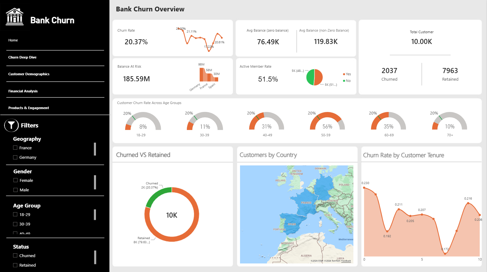

# Bank Churn Dashboard

An interactive, multi-page Power BI dashboard analyzing why bank customers leave (churn) and which customer segments carry the most risk.



## Dataset

Bank customer data for **10,000 customers** in **France, Germany, and Spain**, split into two tables linked one-to-one by `CustomerId`:

| Table | Main columns |
|---|---|
| `Customer_Info` | CustomerId, Surname, CreditScore, Geography, Gender, Age, EstimatedSalary |
| `Account_Info` | CustomerId, Balance, NumOfProducts, HasCrCard, IsActiveMember, Tenure, Exited |

## Data Preparation

Calculated columns (DAX):

- `Age Group`: 18-29, 30-39, 40-49, 50-59, 60-69, 70+
- `Credit Score Band`: Poor, Fair, Good, Very Good, Excellent
- `Balance Band`: Zero, Low, Medium, High
- `Status` / `ExitedName`: Churned / Retained

## Pages

### 1. Home (Executive Overview)
Main KPIs — churn rate, total customers, average balance (all vs. non-zero accounts), balance at risk, active member rate — plus churn by age group (gauges), churned vs. retained split, customers by country, and churn rate by tenure.

### 2. Churn Deep Dive
Churn rate by geography and gender, churn by number of products, a geography × age group heatmap, a decomposition tree, and a Key Influencers visual showing what drives churn.

### 3. Customer Demographics
Customer distribution by age group, gender split by geography, credit score distribution, average balance by geography and gender, and an age-vs-credit-score scatter plot (bubble size = balance, color = churn status).

### 4. Financial Analysis
Average balance by geography, customers by balance band, balance vs. estimated salary, and average balance for churned vs. retained customers.

### 5. Products & Engagement
Customers by number of products, churn rate by card ownership and activity, churn rate by active status, and active rate by tenure.

## Filters

Shared across all pages (synced slicers): **Geography, Gender, Age Group, Status**.
Page-specific filters add further detail where relevant (e.g. number of products, balance band).

## Key Insights

- Overall churn rate is **20.37%** (2,037 of 10,000 customers).
- Churn rises sharply with age, peaking at **56%** for ages 50-59, versus **8%** for ages 18-29.
- **Germany** has the highest churn rate among the three countries, especially among female customers (**37.6%**) and customers aged 50-59 (**70%**).
- Customers with **more than 3 products** are far more likely to churn, as are customers with very low credit scores (≤404).
- **185.59M** in balances is held by customers who left, with Germany accounting for the largest share.
- Customers who churned had a **higher average balance (92K)** than those who stayed (**72K**).
- Customers with **no credit card and low activity** churn the most (**26.85%**), while active cardholders churn the least (**14.27%**).

## Tools

Power BI Desktop, DAX, Power Query

## How to Use

1. Download the `.pbix` file.
2. Open it with [Power BI Desktop](https://powerbi.microsoft.com/desktop/) (free).
3. Use the navigation menu on the left to move between pages, and the slicers to filter by country, gender, age group, or status.

## Repository Structure

```
├── BankChurnDashboard.pbix
├── data/
│   ├── Account_Info.csv
│   └── Customer_Info.csv
├── images/
│   ├── home.png
│   ├── churn_deep_dive.png
│   ├── customer_demographics.png
│   ├── financial_analysis.png
│   └── products_engagement.png
└── README.md
```

## Author

**[Your Name]** | [LinkedIn](https://linkedin.com/in/your-profile)
